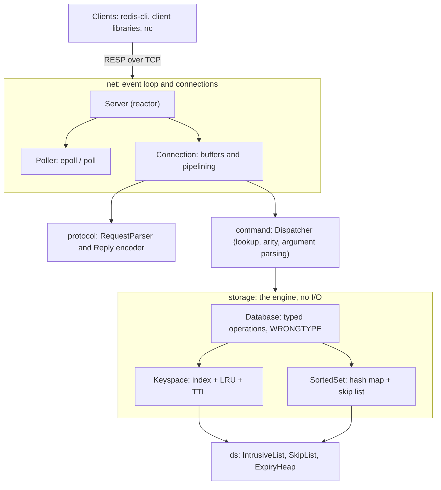

# memkv

A Redis-compatible, in-memory key-value store written from scratch in modern C++20.

memkv speaks the Redis wire protocol (RESP), so the stock `redis-cli`, `redis-benchmark`, and Redis
client libraries work with it unchanged. It supports strings with TTLs, sorted sets with rank and
score range queries, and O(1) LRU eviction. A single-threaded, event-driven server built on
`epoll` serves all clients.

```console
$ redis-cli -p 6380 ZADD leaderboard 1250.5 alice 890 bob 2400 carol
(integer) 3
$ redis-cli -p 6380 ZRANGEBYSCORE leaderboard 1000 3000 WITHSCORES
1) "alice"
2) "1250.5"
3) "carol"
4) "2400"
$ redis-cli -p 6380 SET session:42 token EX 30
OK
```

## Highlights

- **O(1) LRU eviction**: a hash index paired with an intrusive doubly linked list with a sentinel
  node, so every key access and every eviction is constant time with no extra allocation.
- **Sorted sets on a span-augmented skip list**: `ZRANK` and `ZRANGE` by rank run in O(log N), and
  `ZRANGEBYSCORE` in O(log N + K). Each node and its link tower share one allocation.
- **Two-tier TTL expiration**: keys are expired lazily on access and actively by a min-heap, with
  lazy invalidation and amortized compaction. A per-tick budget bounds the work, so a mass expiry
  can't stall the server.
- **Zero-copy, incremental RESP parser**: arguments are views into the connection buffer, so
  parsing does no heap allocation. Requests can arrive split at any byte boundary, and pipelining
  works.
- **Reactor-pattern network layer**: one thread, non-blocking sockets, and a backend-agnostic
  `Poller` (epoll on Linux, poll(2) elsewhere). Commands need no locks and each one is atomic.
- **Tested**: 72 GoogleTest unit and integration tests, including a differential test of the skip
  list against `std::set`. CI runs GCC, Clang, ASan + UBSan, a `redis-cli` smoke test, and a
  clang-format check.

## Quick start

Requirements: a C++20 compiler (GCC 11+ or Clang 14+) and CMake 3.20+. memkv is developed and
tested on Linux (epoll). Other POSIX systems use the portable `poll(2)` backend, which CI also
tests on Linux. GoogleTest is fetched automatically when tests are enabled.

```bash
cmake -S . -B build -DCMAKE_BUILD_TYPE=Release
cmake --build build --parallel
ctest --test-dir build --output-on-failure
```

Run the server and talk to it with any Redis client:

```bash
./build/memkv-server --port 6380 --max-keys 100000
```

```bash
redis-cli -p 6380
```

Without redis-cli, inline commands work over plain TCP:

```bash
printf 'SET greeting hello\r\nGET greeting\r\nQUIT\r\n' | nc localhost 6380
```

| Option | Default | Meaning |
| --- | --- | --- |
| `--host` | `127.0.0.1` | Address to bind |
| `--port` | `6380` | TCP port |
| `--max-keys` | `0` (unbounded) | Evict least recently used keys beyond this many keys |

## Supported commands

| Group | Commands |
| --- | --- |
| Strings | `GET`, `SET key value [NX \| XX] [EX seconds \| PX milliseconds]` |
| Keys | `DEL`, `EXISTS`, `TYPE`, `EXPIRE`, `PEXPIRE`, `TTL`, `PTTL`, `PERSIST` |
| Sorted sets | `ZADD`, `ZREM`, `ZSCORE`, `ZRANK`, `ZCARD`, `ZRANGE [WITHSCORES]`, `ZRANGEBYSCORE [WITHSCORES]` (supports `(` exclusive bounds and `-inf`/`+inf`) |
| Server | `PING`, `ECHO`, `DBSIZE`, `INFO`, `FLUSHALL`, `FLUSHDB`, `QUIT` |

Behavior follows Redis for the details clients notice: `WRONGTYPE` errors, an emptied sorted set
deleting its key, `SET` clearing a previous TTL, `EXPIRE` with a non-positive TTL deleting the key,
and `TTL` returning -2 or -1 for missing or persistent keys.

## Architecture

The code is split into layers. Each layer is a separate CMake library that may link only to the
layers below it, so the build enforces the dependency direction.



| Layer | Directory | Responsibility |
| --- | --- | --- |
| `ds` | `src/memkv/ds` | Generic data structures. Knows nothing about Redis. |
| `storage` | `src/memkv/storage` | The engine: keys, values, eviction, expiration, typed operations. Has no sockets and no protocol, so it is unit-testable with an injected clock. |
| `protocol` | `src/memkv/protocol` | RESP2 request parsing and reply encoding. |
| `command` | `src/memkv/command` | Maps `argv` to engine calls. Owns all argument validation and the mapping of errors to replies. |
| `net` | `src/memkv/net` | Sockets, readiness polling, per-client buffers, the event loop, and the periodic cron. |

### Request lifecycle

1. `Poller::wait` reports a readable socket, and `Connection::receive` appends the bytes to that
   client's input buffer.
2. `RequestParser` extracts every complete request as `string_view` arguments into the buffer.
   Incomplete requests stay buffered, and the parser records how far it got.
3. `Dispatcher` looks up the command, checks arity, parses numbers and options, and calls
   `Database`.
4. The `Reply` is RESP-encoded into the client's output buffer. Replies to pipelined requests
   queue up in order and go out together, usually in a single `send()`.
5. If the socket can't take everything, the connection subscribes to writability until its output
   drains. A client that never reads its replies is disconnected beyond a 64 MB output cap.
6. Every 100 ms, the cron runs one bounded round of active expiration.

## Core data structures

### Keyspace: hash index, LRU list, and expiry heap

```
Keyspace
├── index_        unordered_map<string_view, unique_ptr<Entry>>     key -> Entry in O(1)
├── lru_          IntrusiveList<Entry>
│                 sentinel <-> E1 <-> E2 <-> ... <-> En <-> sentinel
│                              ^ most recently used         ^ evicted next
└── expiry_heap_  min-heap of {deadline, ticket, key}

Entry { const string key; Value value (string | SortedSet);
        optional<TimePoint> expires_at; uint64 expiry_ticket; prev/next links }
```

- The index keys are `string_view`s into each entry's own key string, so a lookup never
  allocates and each key is stored once.
- Each `Entry` embeds its list links (an intrusive hook). Moving an entry to the front on access
  and evicting `lru_.back()` are pointer swaps. The sentinel removes every empty-list and end-node
  special case.
- **Expiration:** setting a TTL pushes `{deadline, ticket, key}` onto the heap and records the
  ticket in the entry. Changing or removing the TTL, or deleting the key, leaves the old heap item
  behind; it's recognized as stale when popped because its ticket no longer matches. When stale
  items outnumber live ones, a single O(n) pass drops them. That pass happens at most once per n/2
  pushes, so the heap stays proportional to the number of keys with a TTL at amortized O(1) extra
  cost.

### Sorted set: hash map plus span-augmented skip list

```
Level 3: HEAD ────────────────────────────► 50 ──────────────────► NIL
Level 2: HEAD ──────────────► 20 ─────────► 50 ──────────────────► NIL
Level 1: HEAD ──────► 10 ───► 20 ───► 40 ─► 50 ─────────► 70 ────► NIL
Level 0: HEAD ─► 05 ► 10 ───► 20 ► 35 ► 40 ─► 50 ─► 60 ──► 70 ────► NIL
              each link also stores its span (level-0 nodes it skips)
```

- `unordered_map<string_view, double>` answers `ZSCORE` and duplicate detection in O(1). Its keys
  are views into member strings owned by skip-list nodes.
- The skip list orders `(score, member)`. Summing link spans along a search path gives a node's
  rank, which makes `ZRANK` and `ZRANGE` by rank O(log N) instead of O(N).
- It uses Redis's parameters: promotion probability 1/4 and at most 32 levels, which averages 1.33
  links per node. Each node and its tower of links share one allocation, avoiding a second cache
  miss per hop.
- Updating a score re-links the existing node rather than reallocating it, so the hash map's views
  stay valid.

### Complexity

| Operation | Average time | Notes |
| --- | --- | --- |
| `GET`, `SET`, `DEL`, `EXISTS` | O(1) | Hash lookup plus O(1) LRU relink |
| `SET ... EX`, `EXPIRE` | O(log E) | Heap push; E = keys with a TTL |
| LRU eviction | O(1) | Unlink the list tail |
| Active expiration tick | O(B log E) | Bounded by the per-tick budget B |
| `ZADD`, `ZREM` | O(log N) per member | |
| `ZSCORE`, `ZCARD` | O(1) | |
| `ZRANK` | O(log N) | Span-sum along the search path |
| `ZRANGE start stop` | O(log N + K) | Jump to `start` by span, then walk K nodes |
| `ZRANGEBYSCORE min max` | O(log N + K) | |

## Performance

All numbers below come from a shared 4-vCPU cloud VM (Intel Xeon @ 2.1 GHz). They vary by about
±15% between runs and will differ on your hardware. Reproduce them with the commands shown.

**Over the network, compared with Redis 7.0.15** (no persistence) on the same machine, using
`redis-benchmark -t set,get,zadd -n 1000000 -r 100000 -c 50 [-P 16]`:

| Requests/sec | memkv | Redis 7.0 | memkv / Redis |
| --- | ---: | ---: | ---: |
| SET, no pipelining | ~92k | ~93k | ~99% |
| GET, no pipelining | ~90k | ~93k | ~97% |
| ZADD, no pipelining | ~74k | ~85k | ~87% |
| SET, pipeline 16 | ~450k | ~625k | ~72% |
| GET, pipeline 16 | ~485k | ~650k | ~75% |
| ZADD, pipeline 16 | ~175k | ~237k | ~74% |

Without pipelining, both servers are bound by syscalls and network round trips, and memkv matches
Redis. With pipelining, per-command CPU dominates. memkv already makes one `recv` and one `send`
per batch, the same as Redis; the remaining gap is user-space CPU (glibc malloc versus Redis's
jemalloc, plus years of Redis micro-optimization).

**In-process engine latency** (`./build/memkv-bench 1000000`, no network, 1M operations per row):

| Operation | ops/sec | p50 | p99 |
| --- | ---: | ---: | ---: |
| SET (new keys) | ~865k | 0.6 µs | 3.5 µs |
| GET (hit, random order) | ~655k | 1.4 µs | 2.8 µs |
| SET with LRU eviction | ~1.45M | 0.5 µs | 1.8 µs |
| ZADD (1M-member set) | ~235k | 3.6 µs | 11 µs |
| ZSCORE | ~685k | 1.3 µs | 2.4 µs |
| ZRANK | ~175k | 5.1 µs | 15 µs |
| ZRANGEBYSCORE (~10 results) | ~140k | 6.3 µs | 25 µs |

Random-order access to a million keys is dominated by cache misses rather than instructions. A
skip-list search touches about 30 nodes at this size, which is why the sorted-set operations cost
more than the hash operations.

## Testing

```bash
ctest --test-dir build --output-on-failure
```

```bash
scripts/smoke_test.sh build/memkv-server
```

The first command runs the GoogleTest suite; the second checks compatibility using the real
`redis-cli`.

- **Unit tests** for every layer. TTL tests use a `ManualClock` that moves time forward
  instantly, so they are deterministic and never sleep.
- **A differential test** runs 20,000 random insert, update, and delete operations on the skip
  list and checks every rank and range against `std::set`.
- **Parser fragmentation tests** feed the same request split at every possible byte boundary.
- **Integration tests** start a real server on an ephemeral port and cover pipelining (1,000
  commands in one write), 4 MB values, `QUIT`, protocol errors, half-closed connections, and
  background expiration.
- **Sanitizers:** configure with `-DMEMKV_SANITIZE=ON` for ASan + UBSan. CI also runs the portable
  `poll(2)` backend with `-DMEMKV_FORCE_POLL=ON`.

## Project layout

```
src/memkv/
  common/    Clock interface, logging, small utilities
  ds/        IntrusiveList, SkipList, ExpiryHeap
  storage/   Keyspace, SortedSet, Database (the engine)
  protocol/  RequestParser, Reply / RESP encoder
  command/   Dispatcher and command table
  net/       Socket helpers, Poller (epoll/poll), Connection, Server
apps/        memkv-server entry point
bench/       In-process storage benchmark
tests/       GoogleTest suite
scripts/     redis-cli smoke test
docs/        Design notes and trade-offs
```

## Limitations and possible extensions

- **No persistence.** Data lives only in memory. A natural next step is an append-only file
  (`appendfsync everysec`) or fork-based snapshots.
- **The key limit counts keys, not bytes.** Redis's `maxmemory` limits bytes, which would need
  per-value size accounting.
- **Exact LRU** costs two extra cache misses per read. Redis approximates LRU by sampling, trading
  accuracy for speed and memory; see [docs/DESIGN.md](docs/DESIGN.md).
- **One thread.** Scaling past one core would mean sharding the keyspace across event loops, each
  with its own LRU and expiry heap.
- **A subset of commands.** There is no `ZREVRANGE`, `LIMIT`, lists, hashes, pub/sub, or
  replication.

[docs/DESIGN.md](docs/DESIGN.md) covers the reasoning behind each design decision and how it
compares with real Redis.
